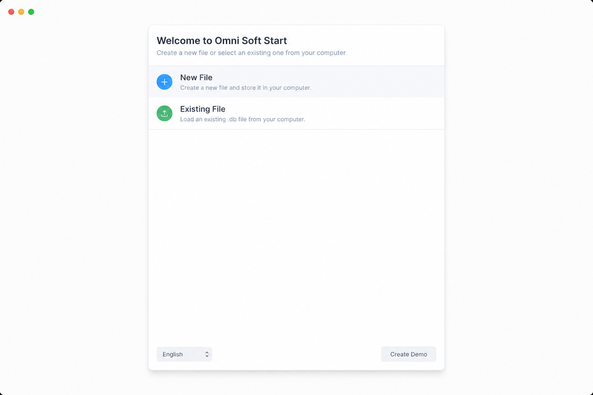

# البدء مع فريبي بوكس

لنبدأ بتطبيق ما تعلمناه حتى الآن عن طريق إعداد شركتك في فريبي بوكس.

إذا لم تقم بتحميل فريبي بوكس، يمكنك تحميله من هنا
[frappebooks.com/download](https://frappebooks.com/download).

## إعداد النسخة

عند فتح فريبي بوكس، سيتم عرض خيارين: **ملف جديد** و**ملف موجود**. إذا كانت هذه هي المرة الأولى التي تفتح فيها فريبي بوكس، انقر على **ملف جديد**.

الآن حدد موقعاً مناسباً حيث تريد تخزين الملف وأعطه اسماً.

::: tip موقع الملف
يخزن فريبي بوكس جميع بيانات شركتك ومعاملاتك في ملف `.db` محلي على جهاز الكمبيوتر الخاص بك.

يمكنك تغيير موقع ملف `.db` هذا. إذا قمت بذلك، يمكنك العثور عليه مرة أخرى عن طريق تحديد خيار **ملف موجود**.
:::

الآن، أدخل اسم العمل، البريد الإلكتروني للعمل ومعلومات الدولة. سيساعد هذا في إعداد دليل الحسابات الصحيح بناءً على دولتك.

::: tip دليل الحسابات
إذا لم تجد دليل الحسابات لبلدك، يمكنك تحديد **دليل الحسابات القياسي**.
:::

---

تهانينا! لديك الآن شركة تم إعدادها على فريبي بوكس.

يمكنك الآن الانتقال إلى الخطوة التالية لإنشاء بعض القيود الأولية قبل أن تتمكن من البدء في تسجيل فواتيرك ومعاملاتك.
