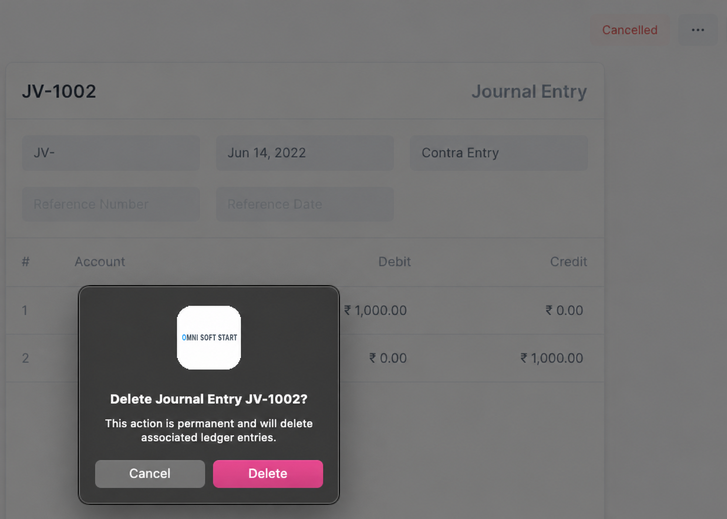

# القيود المعاملاتية

في فريبي بوكس، المعاملات هي نوع خاص من القيود. هذه هي القيود التي تغير رصيد الحساب.

التالي هي القيود المعاملاتية في فريبي بوكس

- فاتورة المبيعات
- فاتورة المشتريات
- المدفوعات
- القيود اليومية

## حالات القيد المعاملاتي

يمر القيد المعاملاتي بالحالات التالية

|   # | الحالة     | في قاعدة البيانات | قابل للتعديل | في التحليلات |
| --: | :-------- | ----------: | -------: | -----------: |
|   1 | مسودة     |          لا |      نعم |           لا |
|   2 | محفوظ     |         نعم |      نعم |           لا |
|   3 | غير محفوظ |          لا |      نعم |           لا |
|   4 | مقدم     |         نعم |       لا |          نعم |
|   5 | ملغي     |         نعم |       لا |           لا |
|   6 | محذوف   |          لا |       لا |           لا |

تحقق من الأقسام أدناه لمزيد من التفاصيل حول هذه الحالات.

## إنشاء قيد

لإنشاء قيد، أولاً انتقل إلى الصفحة، ثم انقر على الزر الأزرق `+`.

::: info نموذج المعاملة
باستثناء المدفوعات، يتم عرض جميع القيود المعاملاتية الأخرى في نماذج الصفحة الكاملة.
يتم عرض المدفوعات في نموذج التعديل السريع.
:::

لتسجيل قيد، يجب أولاً أن يكون _محفوظاً_ ثم _مقدماً_.

### مسودة

في البداية يكون القيد في حالة **مسودة**. هذا يعني أنه لا يزال يمكن تعديل قيمه.

قبل أن يتم حفظ القيد بالنقر على زر الحفظ الأزرق

1. لم يتم تعيين اسم للقيد
2. لم يتم تخزين القيد في قاعدة البيانات بعد

### محفوظ

بعد حفظ القيد المعاملاتي، لا يزال في حالة **مسودة**.

1. تم تعيين اسم للقيد
2. تم تخزين القيد في قاعدة البيانات
3. لا يزال يمكن تعديل القيد

::: info غير محفوظ
عند تعديل قيد محفوظ، تتغير الحالة إلى **غير محفوظ**.

يجب النقر على حفظ لتخزين التغييرات وعند هذه النقطة تعود الحالة إلى **محفوظ**.
:::

### مقدم

بعد حفظ القيد، يجب النقر على إرسال ليتم تسجيل القيد.
سيكون القيد الآن في حالة **مقدم**.

ستعكس شارة الحالة المميزة أعلاه حالة المعاملة.

::: info شارة الحالة
بعض المعاملات مثل فواتير المبيعات والمشتريات ستعرض شارة حالة مختلفة. هذا للإشارة إلى ما إذا تم إجراء دفع.
:::

عند تقديم قيد معاملاتي تحدث عدة أشياء

1. يتم تحديث أرصدة الحسابات
2. يتم إنشاء قيود دفتر الأستاذ

عند التقديم تصبح بعض الخيارات متاحة مثل قيود دفتر الأستاذ

## التحقق من قيود دفتر الأستاذ

النقر على قيود دفتر الأستاذ من القائمة `...` سيعرض الحسابات التي تأثرت بهذه المعاملة في دفتر الأستاذ العام.

## إلغاء وحذف قيد

لحذف قيد يجب أولاً إلغاؤه.

### إلغاء

عند النقر على **إلغاء**، يتم التراجع عن أرصدة الحسابات وقيود دفتر الأستاذ. الآن لن يتم تضمين القيود في أي من التحليلات ولكنها ستظل موجودة في النظام ويمكن تكرارها.

لعرض هذه القيود الملغاة في دفتر الأستاذ العام، انقر على علامة الاختيار تضمين الملغي.

في الصورة أعلاه يمكنك رؤية القيود العكسية التي تم إنشاؤها عند الإلغاء.

### حذف

عند النقر على **حذف**، مطلوب تأكيد لتنفيذ الإجراء.

عند حذف قيد، تتم إزالة جميع آثاره من النظام، وهذا يشمل جميع القيود المرتجعة.

::: danger الحذف
الحذف هو إجراء لا يمكن التراجع عنه. تأكد أنك تريد حقاً حذف قيد قبل المضي قدماً فيه.
:::

---

الآن أنت متمرس جيداً مع القيود المعاملاتية في فريبي بوكس، يمكنك الانتقال إلى تعلم الأنواع الفردية من القيود المعاملاتية.
